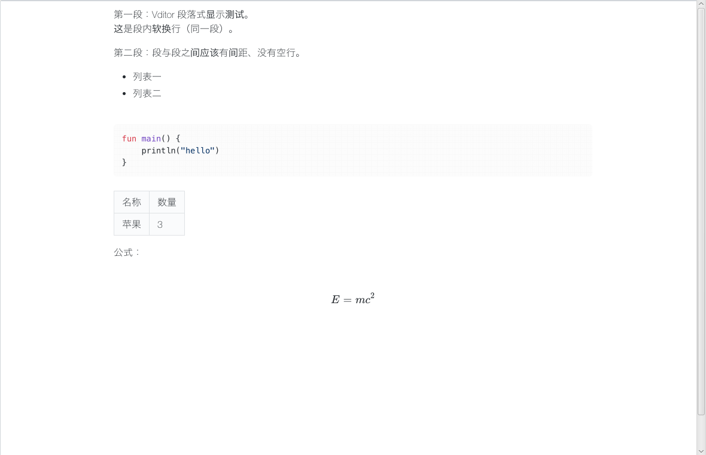
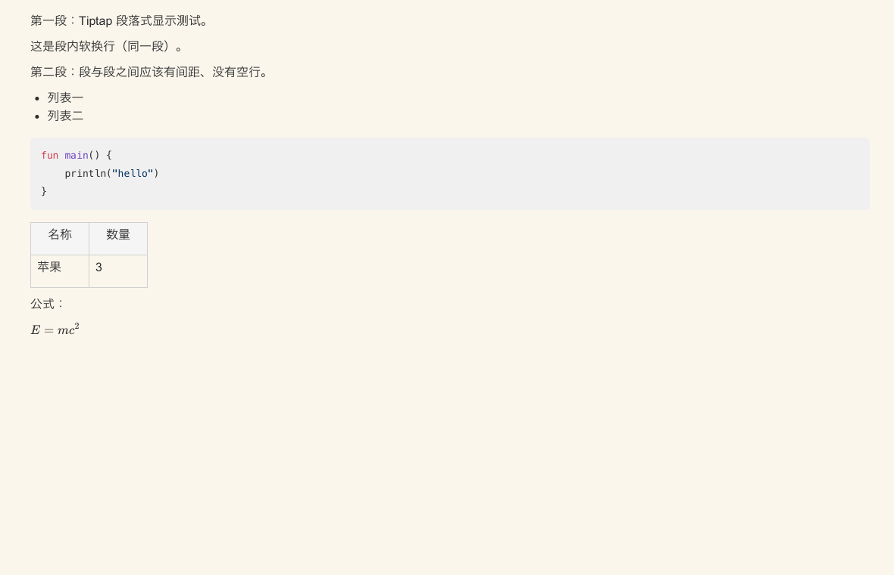

# WebView 段落式编辑器：开源方案调研 + 可行性 spike（2026-11-14）

> 背景：评审意见一要求「段落之间不出现整行空行、段距略大于行距、光标不落分隔处」，Compose 的整篇单文本框做不到（见 [markdown-editor-review-2026-11-12.md](markdown-editor-review-2026-11-12.md) §3.2），于是走 WebView 路线。
> 这篇文档回答：**能否先用开源项目做这件事？** 结论来自实际跑通的 spike（JavaFX WebView 21 + 本机截图），不是只看 README。

## 0. TL;DR

**能借鉴，但不建议整体换编辑器。**

- 实测 1：**Vditor 4.0.1（MIT）** 在 JavaFX WebView 里跑通：IR 模式天然段落式（无空行、1.4 倍段距），代码高亮 / 表格 / KaTeX 公式都正常。坑：file:// 页面 `localStorage` 为 null 要 shim、`cdn` 要指向包根且资源是多文件（lute 3.6MB、highlight、KaTeX）。
- 实测 2：**Tiptap 3.34（MIT）+ 官方扩展**（code-block-lowlight / table / mathematics + KaTeX）用 esbuild 打成**单文件 IIFE**（1.9MB），在 JavaFX WebView 里跑通：段落式 / 代码高亮 / 表格 / 公式全正常。
- 结论：**保留 Tiptap、重建源码工程、借用成熟实现**。我们的自定义语法与交互（`[[原文 => 概念名]]`、`{{…}}`、`:::ai`、`。。。` 槽位、gutter、概念补全、AI 定位、Kotlin↔JS 桥）在 Vditor/Muya 这类完整编辑器上没有扩展点，换过去等于重做或丢掉这些能力。
- 最大前置工程：现在 `app/ui/src/jvmMain/resources/editor/editor.js` 是构建产物，**仓库和 git 历史里都没有源码**。必须先建 `tools/web-editor/`（package.json + src + esbuild 打包），否则只能继续给 bundle 打补丁，借不了扩展。

## 1. 硬约束（JavaFX 21.0.4 WebView 实测）

| 约束 | 说明 / 实测结论 |
|---|---|
| JS 版本 | WebKit 内核，按 `es2017` 保守打包最稳 |
| file:// 存储 | `file://` 页面 `localStorage` 为 **null**，Vditor 直接抛 `TypeError: null is not an object (evaluating 'localStorage.getItem')`；需要内存 shim 或本地 http 服务 |
| 资源加载 | 现在的 Tiptap 是单文件内联；第三方编辑器通常按路径取 lute/highlight/KaTeX 等多文件资源，需要「解包到临时目录 + file://」或起本地 http |
| 中文字体 | CSS **不能写具体字体名**（`"PingFang SC"` 会让中文变乱码，spike 里复现）；用 `-apple-system, sans-serif` |
| 外部脚本编码 | 外部 `.js` 建议显式 `<script charset="utf-8">`，否则中文可能按系统默认编码解析（spike 里复现） |
| 移动端 | Android 没有 JavaFX WebView；若要段落式，需要 Android WebView 或原生方案（另议） |

必须保留的自定义能力（换编辑器时一条都不能丢）：`[[原文 => 概念名]]` 标注与概念高亮、`{{…}}` AI 绿色引号、`:::ai` 块与删除、`。。。` 槽位 + AI 补全浮窗、gutter 段落标记、斜杠菜单、`[[` 概念补全、AI 定位跳转、正文变更回推与失焦回调、页面级快捷键桥、主题变量。

## 2. 候选对照

| 项目 | 版本 / 许可 | 段落式 | 高亮/表格/公式 | 自定义语法扩展性 | JavaFX WebView 适配 | 结论 |
|---|---|---|---|---|---|---|
| **Tiptap** | 3.34.0 / MIT | 可（CSS margin） | 官方扩展都有（MIT） | ★★★★★ 自定义 mark/node、`addKeyboardShortcuts`、ProseMirror 插件 | 已实测（spike 2） | **保留 + 借扩展** |
| **Vditor** | 4.0.1 / MIT | IR 模式天然段落式 | 自带 hljs / 表格 / KaTeX | ★★ 解析器是 Lute（Go→JS），没有自定义 inline mark 扩展点 | 已实测（spike 1） | 只借 CSS/交互/KaTeX 配置，不整体替换 |
| **Muya（marktext）** | 0.2.5 / MIT | 天然段落式 | 自带 | ★★ 内部 DOM 模型，扩展难 | 需 esbuild 重打包（ESM chunked，dist 14MB） | 不推荐（且维护活跃度低） |
| **Milkdown** | MIT | 可 | 插件化可加 | ★★★★ ProseMirror 插件体系 | 需打包（ESM） | 备选；重写成本比 Tiptap 更高 |
| **Novel** | Apache-2.0（参考） | — | Tiptap 扩展示例 | — | 不是独立编辑器 | **AI 补全/键位的参考实现** |
| Toast UI / Lexical / BlockNote | — | 可 | 有 | 需大改 | 未深入 | 过重、带自己的一套 UI，与宿主冲突 |

许可核对来源：各仓库 LICENSE 原文 + npm registry 元数据（2026-11-14 查）。

## 3. spike 记录（可复跑）

### 3.1 方法

- 环境：JDK 17 + JavaFX 21.0.4（项目已依赖）+ macOS arm64；用 `jcmd`/`jps` 之外的小 harness：`Platform.startup` → `WebView.load(file:///.../index.html)` → 等 9s → `WebView.snapshot()` 写 PNG。
- 页面：本地 `index.html` + 本地资源（不连网），分别加载 Vditor dist 与 Tiptap spike bundle。

### 3.2 Vditor

- 版本/体积：4.0.1，`dist/index.min.js` 290KB；必需资源 `dist/js/lute/lute.min.js` 3.6MB + highlight.js/KaTeX 等（全量 dist 23MB，可按需裁剪）。
- 结果：IR 模式正常工作，中文段落式排版（无空行、约 1.4 倍段距）、列表、代码高亮、表格、KaTeX 公式全部正常。
  
- 坑：`localStorage` null 要 shim；`cdn` 必须指向**包根**（Vditor 自己拼 `/dist/js/...`）；资源多文件，不能单文件内联。

### 3.3 Tiptap 3 + 官方扩展

- 依赖（全部 MIT）：`@tiptap/core@3.34`、`starter-kit`、`@tiptap/extension-code-block-lowlight`、`lowlight@3`、`highlight.js@11`、`@tiptap/extension-table`（+row/cell/header）、`@tiptap/extension-mathematics`、`katex@0.16`；esbuild 打 IIFE（含常用语言 + KaTeX 共 1.9MB）。
- 结果：段落式、列表、**代码块语法高亮**、**表格**、**KaTeX 公式**全部正常，单文件资源、无 localStorage 依赖。
  
- 说明：这个 spike bundle 里还没有我们的自定义 marks/gutter/bridge，但它证明了目标架构（Tiptap 3 + 官方扩展 + esbuild 单文件）在项目 WebView 里可用。

### 3.4 Phase 0 结果：新源码实现已替换旧 bundle（2026-11-14）

`tools/web-editor/` 用 Tiptap 3 + marked + turndown 重写了编辑器并接管了 `resources/editor/editor.js`。
与旧 bundle 在 16 个夹上的对比（基线 JSON 在 `tools/web-editor/docs/`，截图 `docs/assets/markdown-webview-new-editor.png`）：

| 夹具 | 旧 bundle | 新实现 |
|---|---|---|
| 代码围栏 | 退化成 4 空格缩进代码块、语言丢失 | 围栏 + 语言保留 |
| 表格 | 拍平成一整段文字 | GFM 表格往返 |
| 任务清单 | checkbox 丢失 | `- [ ]`/`- [x]` 保留 |
| `[[原文 => 概念名]]` | `>` 被转义，映射丢失 | 往返正常 |
| `:::ai` 块 | 不识别、压成段落 | 识别为块节点并往返 |
| 段内软换行 | 合并成空格 | 保留换行 |
| 空文档 | `getMarkdown()` 返回 `"\n"` | 返回空串 |

新实现仍然完全满足「块级 DOM + CSS margin」的段落式显示；代码高亮/公式/AI 补全浮窗/自定义键位是下一步（Phase 1–3）。

## 4. 借鉴清单（可直接用的包/实现）

| 用途 | 来源 | 版本 | 许可 | 说明 |
|---|---|---|---|---|
| 代码高亮 | `@tiptap/extension-code-block-lowlight` + `lowlight` + `highlight.js` | 3.34 / 3.3 / 11.x | MIT | 官方扩展，CSS 用 hljs 主题 |
| 表格 | `@tiptap/extension-table`（row/cell/header） | 3.34 | MIT | 官方扩展 |
| 公式 | `@tiptap/extension-mathematics` + `katex` | 3.34 / 0.16 | MIT | 官方扩展，需 KaTeX CSS/字体 |
| 斜杠菜单 | `@tiptap/suggestion` + `@floating-ui/dom` | 3.34 | MIT | 官方 suggestion 机制 |
| AI 补全交互 | Novel `packages/headless/src/extensions/ai-highlight.ts`、`apps/web/components/tailwind/generative/ai-completion-command.tsx` | 仓库 main | Apache-2.0 | accept/replace/discard 的交互与装饰；复制需在 NOTICE 署名 |
| 自定义键位 | Novel `packages/headless/src/extensions/custom-keymap.ts` + Tiptap `addKeyboardShortcuts` | — | Apache-2.0 / MIT | 键位映射由 Kotlin 侧 `window.setKeymap` 下发 |
| 代码块 Tab | `prosemirror-commands` 的 `insertTab` / 自定义 command | — | MIT | 配合 `addKeyboardShortcuts` |
| 段落排版/代码主题 | Vditor 的 CSS、我们现有 `index.html` | — | MIT / 自有 | 保留 1.42 倍段距口径 |
| Markdown 序列化 | `tiptap-markdown`（或保留现有 turndown 逻辑） | 最新 | MIT | 换 markdown 解析/序列化时用 |

## 5. 落地计划（建议顺序）

> 2026-11-14 进展：**Phase 0 已落地**——`tools/web-editor/` 源码工程建好（Tiptap 3 + marked + turndown + esbuild），产物替换了原来的黑盒 bundle；仓库内 JavaFX WebView 回归 harness 跑通（16 夹具，旧/新基线 JSON 见 `tools/web-editor/docs/`）。新实现在代码围栏/表格/任务清单/概念映射/AI 块/软换行上已经优于旧 bundle（对照见该目录 README）。下一步按下面阶段 1–3 接代码高亮、公式、AI 补全浮窗、自定义键位。

0. **前置：建源码工程**（最大工作量，必须先做）
   - 新建 `tools/web-editor/`：`package.json` + `src/`（TypeScript 或 JS）+ esbuild 脚本，产出 `app/ui/src/jvmMain/resources/editor/editor.js`（以及 `index.html`）。
   - 先把**当前 bundle 的行为**按 `docs/knowledge-base-draft.md` §13 清单重写成源码：marks（bold/italic/code/strike/link/concept/ai）、`[[原文 => 概念名]]`、`{{…}}`、`:::ai`、gutter node decoration、斜杠菜单、`[[` 补全、主题变量、Kotlin 桥（`onUpdate`/`onBlur`/`onShortcut`/`reveal`/`setMarkdown`）。
   - 用 spike 的 JavaFX harness 做回归：`setMarkdown → 截图/JS 断言`，覆盖行为清单。
1. **借扩展**：代码高亮（lowlight）→ 表格（table）→ 公式（mathematics + KaTeX）。
2. **AI 补全浮窗**：借 Novel 的 `ai-highlight` + accept/replace/discard，接 Kotlin 现有 `onRequestAiFill` 与 `。。。` 槽位。
3. **自定义键位 + 代码块 Tab + 斜杠菜单 suggestion**：`window.setKeymap` 下发 + Tiptap keymap 扩展。
4. **段落式设为默认**（JavaFX 起不来自动回退 Compose，已实现），安卓端另评。

## 6. 风险 / 不做

- 重写当前 bundle 有**行为漂移**风险（跨段选择、gutter、IME、主题）：用 §13 行为清单 + JavaFX harness 断言 + 真机交互兜底。
- **不整体换 Vditor/Muya/Milkdown**：会丢自定义语法/交互，或者要重写同样多的东西。
- Apache-2.0 代码复制需保留 NOTICE 与许可声明；MIT 需保留版权声明。
- 移动端 WebView 可行性另议（Android WebView 或原生编辑控件）。
- 不做：带完整工具栏的第三方编辑器 UI（与宿主界面冲突）、CDN 依赖（必须离线打包）。

## 7. 复跑方式（本机）

```bash
# 1) 取 Vditor（MIT）
npm pack vditor@4.0.1 && tar xzf vditor-4.0.1.tgz
# 2) Tiptap spike
mkdir tiptap-spike && cd tiptap-spike
# package.json 见本文 §3.3 的依赖；main.js 内容为一个 Editor + 官方扩展
npx esbuild src/main.js --bundle --format=iife --target=es2017 --outfile=demo/dist/spike.js
# 3) JavaFX WebView harness（约 40 行 Java）：加载 demo/index.html → 等 9s → snapshot 成 PNG
```

（spike 产物在本次会话的临时目录里，只保留了截图；正式落地时会进 `tools/web-editor/`。）
